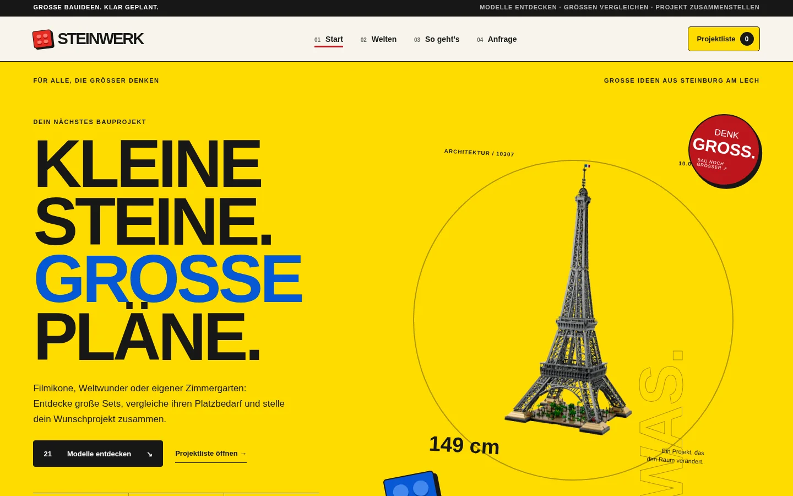
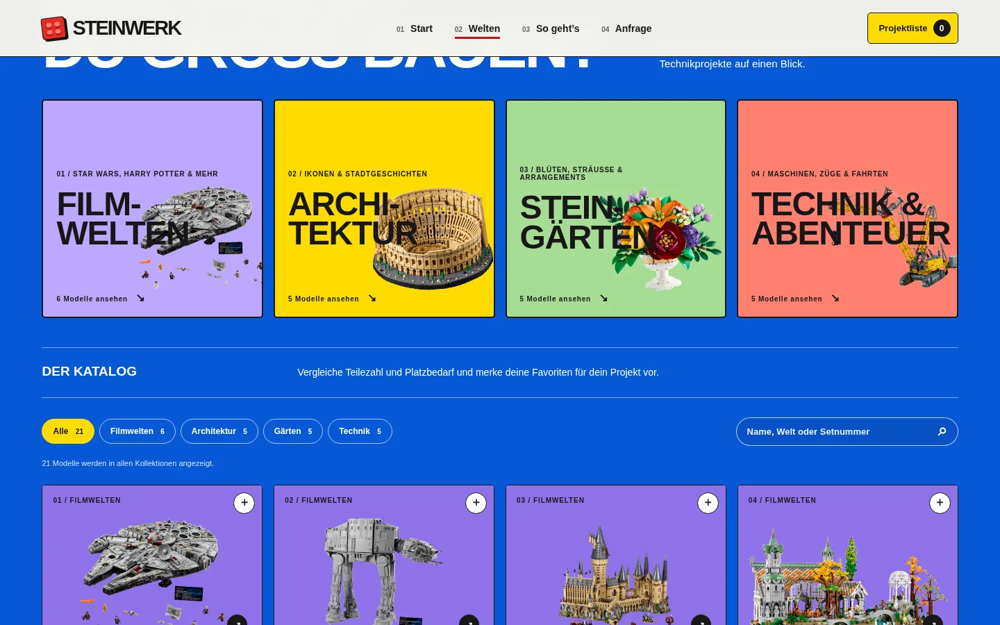
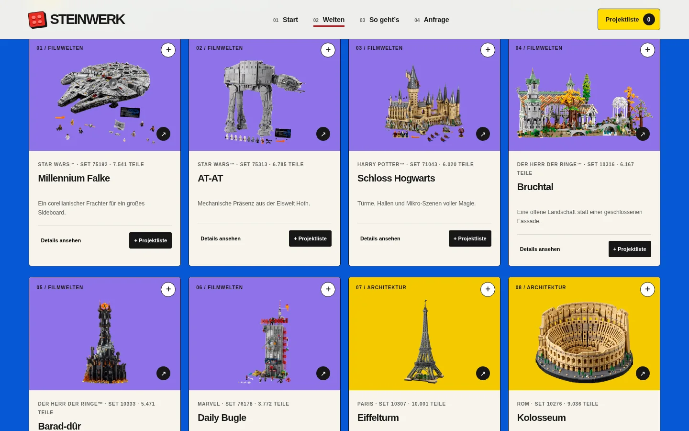
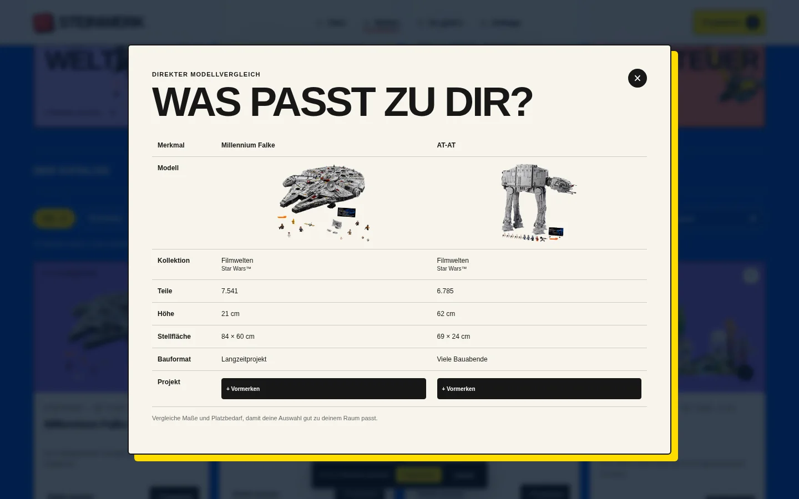
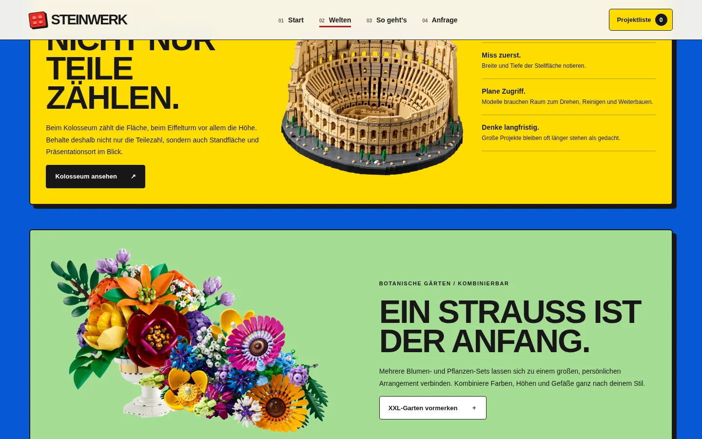
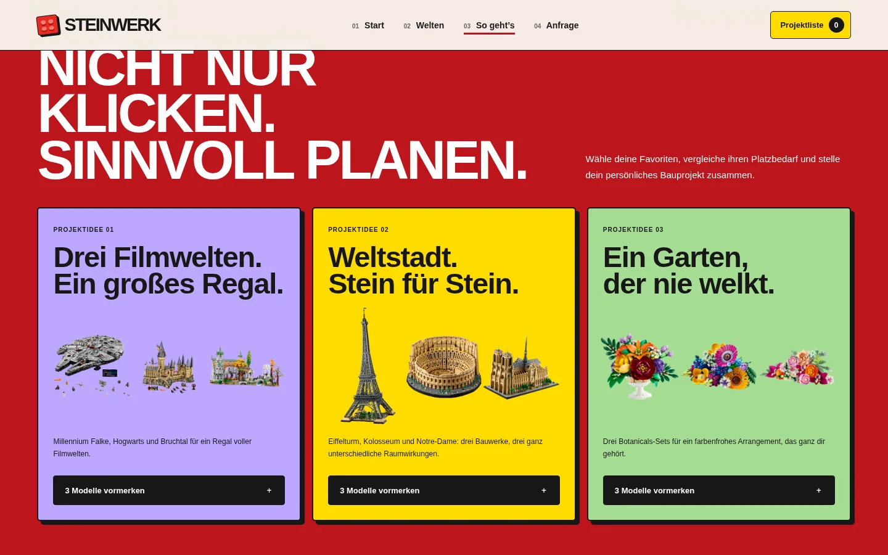
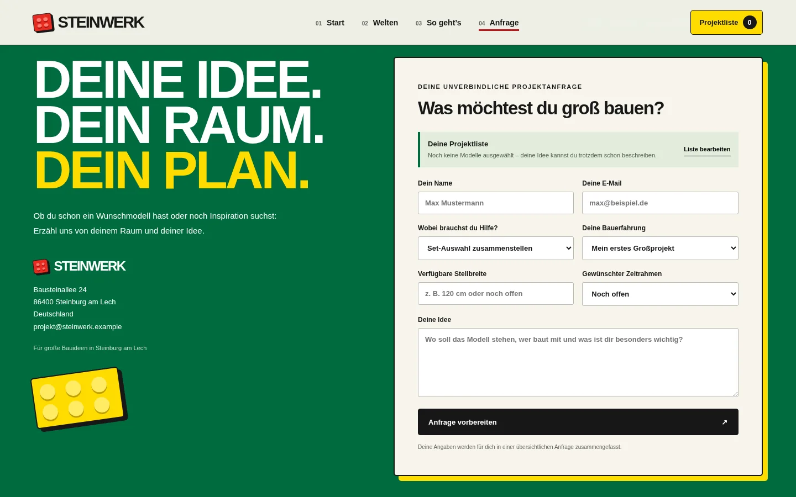
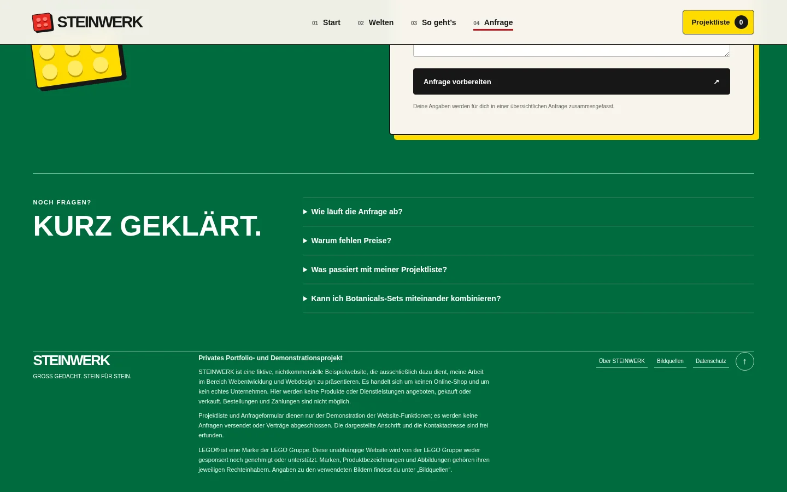
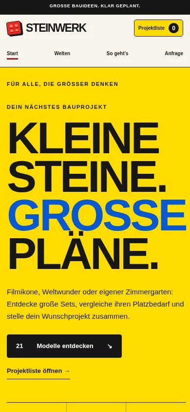

# STEINWERK – Große LEGO®-Bauprojekte entdecken und planen

**Interaktive, responsive Portfolio-Website mit Modellkatalog, Vergleichsfunktion und persönlicher Projektliste.**

**[Live-Demo](https://dmytro-moldovanu.github.io/Steinwerk/)** · **[GitHub-Repository](https://github.com/Dmytro-Moldovanu/Steinwerk)**

**Technologien:** HTML5 · CSS3 · JavaScript (ES6+) · DOM-Manipulation · Web Storage API (`localStorage`) · GitHub Pages



## Projektüberblick

Große LEGO®-Modelle unterscheiden sich nicht nur im Motiv, sondern auch in ihrer Teilezahl, ihrem Platzbedarf und dem Aufwand beim Aufbau. **STEINWERK** macht diese Informationen in einer visuell gestalteten Weboberfläche vergleichbar. Besucherinnen und Besucher können Modelle entdecken, gezielt filtern, miteinander vergleichen und daraus eine eigene Projektliste zusammenstellen.

Das Konzept orientiert sich an einem modernen Produktkatalog, ergänzt um Funktionen zur Planung größerer Bauvorhaben. Die Umsetzung erfolgt **rein clientseitig**: Es gibt weder einen Backend-Server noch eine Datenbank oder eine echte Bestellabwicklung.

Der Katalog umfasst **21 Modelle in vier Themenwelten**: Filmwelten, Architektur, Botanische Gärten sowie Technik & Abenteuer.

## Rundgang durch die Website

Die Anwendung besteht aus **einer durchgehenden Seite mit vier per Navigation erreichbaren Abschnitten**. Zusätzliche Detailansichten, Vergleiche und die Projektliste werden als interaktive Dialogfenster dargestellt.

### 01 · Start – „Kleine Steine. Große Pläne.“

Der Einstieg stellt die Idee des Projekts vor: große Bauideen entdecken und realistisch planen. Ein auffälliger gelber Hero-Bereich, typografische Akzente und ein hervorgehobenes Architekturmodell sorgen für einen klaren ersten Eindruck. Von hier aus führen direkte Aktionen zum Modellkatalog und zur Projektliste.

### 02 · Welten – Themen entdecken und Modelle auswählen



Der blaue Katalogbereich gliedert die Modelle in vier visuell unterscheidbare Themenwelten. Themenkarten und Kategorienfilter ermöglichen einen schnellen Einstieg in die gewünschte Modellgruppe.



**Interaktive Katalogfunktionen:**

- Freitextsuche nach Modellnamen und weiteren Katalogmerkmalen.
- Filter nach Themenwelt mit der Möglichkeit, alle Filter zurückzusetzen.
- Modellkarten mit Setnummer, Teilezahl, Kurzbeschreibung und Detailansicht.
- Detaildialoge mit Maßen, Bauformat, Planungshinweis und Verweis auf die jeweilige Produktseite.
- Modelle für die Projektliste vormerken und zur Vergleichsauswahl hinzufügen.

#### Modellvergleich



Bis zu **drei Modelle** können direkt gegenübergestellt werden. Die Vergleichstabelle zeigt unter anderem Teilezahl, Höhe, Stellfläche und Bauformat. So lassen sich Unterschiede bei Platzbedarf und Größenordnung vor der Auswahl besser einschätzen.

#### Inspirationsbereiche



Zusätzliche visuelle Themenblöcke präsentieren ausgewählte Architektur- und Pflanzenmodelle und zeigen, wie unterschiedliche Sets als größere Bauideen kombiniert werden können.

### 03 · So geht’s – Von der Idee zum Bauprojekt



Dieser Bereich zeigt einen verständlichen Planungsablauf: **entdecken, vergleichen, die Projektliste zusammenstellen und eine Anfrage vorbereiten**. Dazu kommen beispielhafte Kombinationen für Filmwelten, Architektur und botanische Projekte.

Die **Projektliste** ist interaktiv: Modelle können hinzugefügt, entfernt und in ihrer Menge angepasst werden. Die Anwendung berechnet die Anzahl der ausgewählten Sets und die gesamte Teilezahl. Die Auswahl wird lokal im Browser gespeichert und bleibt nach dem Neuladen verfügbar.

### 04 · Anfrage – Ein Projekt strukturiert vorbereiten



Der abschließende Abschnitt enthält ein Formular, in dem Interessierte ihr Bauvorhaben beschreiben können. Dazu gehören unter anderem die Auswahl aus der Projektliste, Bauvorhaben, Erfahrung, verfügbarer Platz und Zeitrahmen.

Aus den Angaben erstellt die Website **eine strukturierte Textzusammenfassung**, die sich kopieren lässt. **Es wird keine Nachricht versendet und keine Bestellung ausgelöst.** Die Funktion demonstriert die Aufbereitung von Formulardaten ohne externe Serverdienste.



Ein FAQ-Bereich klärt häufige Fragen zur Projektauswahl, zur Funktionsweise der Anfrage und zum Umgang mit gespeicherten Daten.

## Funktionen auf einen Blick

| Bereich | Umsetzung |
| --- | --- |
| Modellkatalog | 21 Datensätze mit Kategorien, Setnummern, Abmessungen und Produktinformationen |
| Suche & Filter | Live-Suche und thematische Filterung der Modellkarten |
| Detailansichten | Interaktive Dialogfenster mit Produktdaten und Planungshinweisen |
| Vergleich | Gegenüberstellung von bis zu drei Modellen in einer Tabelle |
| Projektliste | Merkliste mit Mengensteuerung und automatischer Summierung der Teilezahl |
| Persistenz | Speicherung der Projektliste über `localStorage` |
| Projektanfrage | Formular mit lokaler Erstellung und Kopierfunktion einer Textzusammenfassung |
| Benutzeroberfläche | Responsive Layouts, farbige Seitenabschnitte und anpassungsfähige Navigation |
| Bedienbarkeit | Semantische HTML-Elemente, Sprunglink, Tastaturfokus und Rücksicht auf reduzierte Animationen |

## Technische Umsetzung

STEINWERK wurde als **statische Webanwendung ohne Frontend-Framework** umgesetzt.

- **HTML5:** semantische Seitenstruktur, Navigationsanker, Formularfelder und native Dialogelemente.
- **CSS3:** Grid- und Flexbox-Layouts, responsives Design, Farbsystem, Typografie und Animationen.
- **JavaScript (ES6+):** Katalogdaten, dynamische Erzeugung der Modellkarten, Suche, Filter, Vergleiche, Dialoge und Formularlogik.
- **Web Storage API:** Speichern und Wiederherstellen der persönlichen Projektliste im Browser.
- **GitHub Pages:** Bereitstellung der Website ohne eigenen Server.

Die Modellinformationen sind als strukturierte JavaScript-Objekte organisiert. Für schnellen Zugriff werden Modelle anhand ihrer Setnummer referenziert. Benutzeraktionen aktualisieren die betroffenen Ansichten direkt im Browser.

### Projektstruktur

```text
STEINWERK/
├── index.html             # Seitenstruktur, Navigation und Formular
├── style.css              # Layout, Farben, Komponenten und Responsive Design
├── script.js              # Katalog, Filter, Vergleich und Projektlogik
├── assets/
│   ├── *.png              # Abbildungen der 21 Modelle
│   └── SOURCES.md         # Bildquellen und Verweise zu Produktinformationen
├── screenshots/           # Screenshots für die Projektdokumentation
└── README.md              # Projektbeschreibung
```

### Responsive Darstellung

Die Website passt Navigation, Inhaltsbreite, Modellraster und Formulare an unterschiedliche Bildschirmgrößen an.




**Vorgesehene Live-Adresse:** https://dmytro-moldovanu.github.io/Steinwerk/

## Projektcharakter und Quellen

STEINWERK ist ein **nicht kommerzielles Demonstrationsprojekt für ein persönliches Webentwicklungs-Portfolio**. Die Website verkauft keine Produkte, verarbeitet keine Zahlungen und versendet keine Anfragen. Die dargestellten Kontaktdaten sind fiktiv.

LEGO® ist eine Marke der LEGO Gruppe. Dieses unabhängige Projekt wird von der LEGO Gruppe weder gesponsert noch autorisiert oder unterstützt.

Die Quellen der Modellabbildungen und Verweise zu den Produktdaten sind in [`assets/SOURCES.md`](assets/SOURCES.md) dokumentiert.
